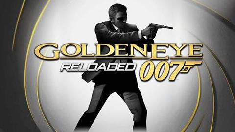

# GoldenEye007ReloadedRecomp

<div align="center">
  
</div>

A static recompilation of [**GoldenEye 007: Reloaded**](https://en.wikipedia.org/wiki/GoldenEye_007:_Reloaded)
(Xbox 360, 2011, Title ID `415608AF`) to native PC, built on the
[ReXGlue SDK](https://github.com/rexglue/rexglue-sdk). The game's PowerPC code
is translated into C++ and compiled. There is no emulator.

> This project is not affiliated with Activision, Eurocom or MGM. It contains
> no game files: you need your own legally owned copy of the game.

## Status

- Boots to the main menu with video, audio and controller input.
- Single player works: training and the first mission load and play.
- A full playthrough hasn't been tested yet. Multiplayer is not implemented.
- Optional patches from xenia-canary: no lens flares, 16x anisotropic
  filtering.

## Requirements

- CMake 3.25+, Ninja, and Clang/LLVM. MSVC alone won't build this.
- The game's files, extracted from your disc or ISO with
  [extract-xiso](https://github.com/XboxDev/extract-xiso/releases).

Check that your dump is the expected retail release:

| | |
|---|---|
| Title ID | `415608AF` |
| Media ID | `40583A82` |
| Module hash | `065D6021C0BDD535` |
| XEX timestamp | `4E88BBE7` (2011-10-02) |

## Build

1. Clone the repo with its submodule. The ReXGlue SDK is built from source
   (`thirdparty/rexglue-sdk`).

   ```
   git clone --recursive <repo-url>
   ```

   If you already cloned without it, run `git submodule update --init --recursive`.
2. Extract the ISO (`extract-xiso -x GoldenEye.iso`) and copy its contents
   into `assets/` (gitignored):

   ```
   assets/
     Default.xex
     DATA/
     nxeart
   ```
3. Build:

   ```
   cmake --preset win-amd64-release
   cmake --build --preset win-amd64-release
   ```

   There are also Linux and macOS presets (`linux-amd64-*`, `mac-*`), but only
   Windows is tested. Codegen (`Default.xex` → `generated/`) runs automatically
   as part of the build.

## Run

```
out\build\win-amd64-release\goldeneye007reloadedrecomp.exe
```

Game files are found in `<repo>/assets` automatically; use `--game_data_root`
to point somewhere else. Logs go to `out\build\<preset>\logs\`.

## Configuration

All settings live in [`settings/`](settings/README.md) and are loaded at startup.
CLI flags and `REX_*` environment variables override them.

| File | What it covers |
|---|---|
| `hardware.toml` | renderer, window, `gpu_wait_mode`, language (`user_language`), patches (`disable_lens_flares`, `anisotropic_filtering_16x`) |
| `mapping.toml` | input backend, keyboard and mouse |

## Development notes

- The game's Lua 5.1 handles errors with `setjmp`/`longjmp`. Their addresses are
  set in `default_functions.toml`; without them any Lua error ends in `exit(1)`
  and a crash. `src/lua_error_hook.cpp` logs every Lua error.
- `vrlb` isn't supported by the SDK codegen; it's replaced by `[[midasm_hook]]`s
  in `src/vrlb_fixups.cpp`. The patches are `[[midasm_hook]]`s too
  (`src/game_patches.cpp`): instruction bytes written to guest memory are never
  executed in a recompiled game.
- Set `dev_debug_runtime = true` to stub every unknown function and log
  missing ones to `logs/stub_sweep.txt` and `logs/missed_functions.txt`.

## Credits

- [ReXGlue SDK](https://github.com/rexglue/rexglue-sdk), whose runtime is
  derived from [Xenia](https://github.com/xenia-project/xenia)
- [xenia-canary/game-patches](https://github.com/xenia-canary/game-patches),
  the source of the optional patches
- [SDL_GameControllerDB](https://github.com/mdqinc/SDL_GameControllerDB),
  for `settings/gamecontrollerdb.txt` (zlib license)
- [extract-xiso](https://github.com/XboxDev/extract-xiso), for dumping the game

## License

MIT. See [LICENSE](LICENSE). This applies to this project's own code only, not
to the game or its assets.
