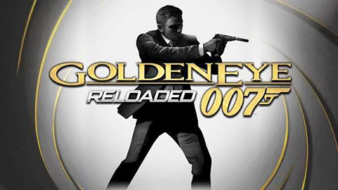

# GoldenEye007ReloadedRecomp

<div align="center">
  
</div>

A static recompilation of [**GoldenEye 007: Reloaded**](https://en.wikipedia.org/wiki/GoldenEye_007:_Reloaded)
(Xbox 360, 2011, Title ID `415608AF`) to native PC, built on the
[ReXGlue SDK](https://github.com/rexglue/rexglue-sdk). The game's PowerPC code
is translated into C++ and compiled. There is no emulator.

> This project is not affiliated with Activision, Eurocom or MGM. It contains
> no game files: you need your own legally owned copy of the game.
> This is fan research project.

## Status

- Boots to the main menu with video, audio and controller input.
- Single player works: training and the first mission load and play.
- Online multiplayer is not implemented.
- Local split-screen: the runtime can sign in a second player on a second
  gamepad (enabled in `hardware.toml`, see [`settings/split-screen.md`](settings/split-screen.md)).
- Optional patches from xenia-canary: no lens flares, 16x anisotropic
  filtering.
- Two renderers (`gpu_plugin` in `hardware.toml`): `xenos`, the Xenos GPU
  emulation, and `native` (experimental, Vulkan only), which draws the game's
  commands directly with the host API. The checked-in config uses `native`.
- A launcher (`goldeneye007reloadedrecomp_launcher.exe`) to pick the main
  settings and start the game.

## Requirements

- CMake 3.25+, Ninja, and Clang/LLVM. MSVC alone won't build this.
- The game's files, extracted from your disc or ISO with
  [extract-xiso](https://github.com/XboxDev/extract-xiso/releases).

Check that your dump is the expected retail release:

| | |
|---|---|
| Title ID | `415608AF` |
| Media ID | `40583A82` |
| Module hash | `065D6021C0BDD535` |
| XEX timestamp | `4E88BBE7` (2011-10-02) |

## Build

1. Clone the repo with its submodule. The ReXGlue SDK is built from source
   (`thirdparty/rexglue-sdk`).

   ```
   git clone --recursive <repo-url>
   ```

   If you already cloned without it, run `git submodule update --init --recursive`.
2. Extract the ISO (`extract-xiso -x GoldenEye.iso`) and copy its contents
   into `assets/` (gitignored):

   ```
   assets/
     Default.xex
     DATA/
     nxeart
   ```
3. Build:

   ```
   cmake --preset win-amd64-release
   cmake --build --preset win-amd64-release
   ```

   There are also Linux and macOS presets and ARM64 ones (`linux-amd64-*`,
   `win-arm64-*`, `linux-arm64-*`, `mac-amd64-*`, `mac-arm64-*`), but only
   Windows x64 is tested. Windows builds include Direct3D 12, Vulkan and the
   experimental Direct3D 11 backend (`graphics_backend` in `hardware.toml`)
   for the `xenos` renderer, and the Vulkan-only `native` renderer
   (`rexgpu-native.dll`). Codegen (`Default.xex` → `generated/`) runs automatically
   as part of the build.

## Run

```
out\build\win-amd64-release\goldeneye007reloadedrecomp.exe
```

Game files are found in `<repo>/assets` automatically; use `--game_data_root`
to point somewhere else. Logs go to `out\build\<preset>\logs\`.

Or start the launcher next to it:

```
out\build\win-amd64-release\goldeneye007reloadedrecomp_launcher.exe
```

It edits `settings/hardware.toml` and `settings/mapping.toml` in place (only
the changed lines), starts the game, and reopens with Safe mode if the game
crashes. Its page for this game (name, colours, wordmark, the Game and
Controls rows) is [`launcher/launcher.toml`](launcher/launcher.toml); the
format is described in the SDK's `docs/launcher.md`.

## Configuration

All settings live in [`settings/`](settings/README.md) and are loaded at startup.
CLI flags and `REX_*` environment variables override them.

| File | What it covers |
|---|---|
| `hardware.toml` | renderer (`gpu_plugin`: `native`, `xenos`; `graphics_backend`: `any`, `d3d12`, `vulkan`, `d3d11`), upscaling, window, `gpu_wait_mode`, language (`user_language`), local players for split-screen (`max_local_users`, `keyboard_own_player`), patches (`disable_lens_flares`, `anisotropic_filtering_16x`) |
| `mapping.toml` | input backend, keyboard and mouse |

All SDK rendering options are described in [`settings/faq.md`](settings/faq.md).

## Development notes

- Set `dev_debug_runtime = true` to stub every unknown function and log
  missing ones to `logs/stub_sweep.txt` and `logs/missed_functions.txt`.
- Codegen keeps CR, CTR, XER, the reserved register, r14-r31 and r0, r2, r11,
  r12 in C++ locals (`*_as_local` in
  `goldeneye007reloadedrecomp_manifest.toml`). Changing them regenerates all
  of `generated/`. The GPR locals pay off only with ISO volatile semantics, so
  Windows builds use `/volatile:iso` / `-fno-ms-volatile`
  (`generated/rexglue.cmake`).
- The game's XDK `memcpy` / `memset` / `memmove` run as host code
  ([`src/render/native_memory_hook.cpp`](src/render/native_memory_hook.cpp),
  cvar `native_memory`).

## Credits

- [ReXGlue SDK](https://github.com/rexglue/rexglue-sdk), whose runtime is
  derived from [Xenia](https://github.com/xenia-project/xenia)
- [xenia-canary/game-patches](https://github.com/xenia-canary/game-patches),
  the source of the optional patches
- [SDL_GameControllerDB](https://github.com/mdqinc/SDL_GameControllerDB),
  for `settings/gamecontrollerdb.txt` (zlib license)
- [extract-xiso](https://github.com/XboxDev/extract-xiso), for dumping the game
- Cinzel and Exo 2, the launcher's fonts (SIL OFL 1.1, see
  [`launcher/fonts/`](launcher/fonts/README.md))

## License

MIT. See [LICENSE](LICENSE). This applies to this project's own code only, not
to the game or its assets.
